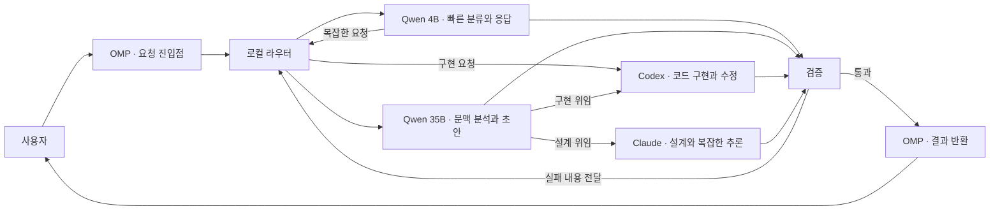

# AgentMesh

로컬 LLM과 클라우드 에이전트를 함께 사용하는 작업 환경의 **구조와 운영 규칙**을 정리하는 저장소입니다.

목표는 빠른 응답, 필요한 만큼의 모델 사용, 검증된 결과입니다. 아래 구조는 설계 기준이며 실제 연동이나 성능 측정을 뜻하지 않습니다.

## 작업 환경 구조

버튼 없이 자동으로 반복 재생됩니다. 로컬 응답, 코드 구현, 설계, 검증 실패 후 재작업 경로를 차례로 보여주는 흐름 예시입니다.

### 정적 구조도

| 구성요소 | 역할 |
| --- | --- |
| OMP | 요청을 받고 작업 흐름을 조정하며 최종 결과를 반환 |
| 로컬 라우터 | 작업 유형과 복잡도에 따라 처리 경로 결정 |
| Qwen 4B | 빠른 분류, 간단한 질문, 짧은 요약 |
| Qwen 35B | 긴 문맥 분석, 요구사항 정리, 초안 생성 |
| Codex | 코드 구현, 수정, 테스트 작업 |
| Claude | 아키텍처 설계, 복잡한 추론과 검토 |
| 검증 | 요구사항 충족 여부 확인, 실패 시 재작업 요청 |

OMP는 이 문서의 요청 진입점 역할명입니다. Qwen 4B와 Qwen 35B는 모델 역할을 나타내는 표시명이며, 정확한 배포판·양자화·실행 환경은 실제 환경에 맞춰 별도로 정합니다.

## 대표 요청 흐름

| 작업 | 흐름 |
| --- | --- |
| 간단한 응답 | OMP → 라우터 → Qwen 4B → 검증 → 결과 반환 |
| 긴 문맥 분석 | OMP → 라우터 → Qwen 4B 분류 → 라우터 → Qwen 35B → 검증 → 결과 반환 |
| 코드 구현 | OMP → 라우터 → Qwen 4B 분류 → 라우터 → Qwen 35B 문맥 정리 → Codex → 검증 → 결과 반환 |
| 설계 | OMP → 라우터 → Qwen 4B 분류 → 라우터 → Qwen 35B 문맥 정리 → Claude → 검증 → 결과 반환 |
| 재작업 | 검증 실패 → 라우터 → 담당 모델에 실패 내용 전달 → 수정 → 재검증 |

분류와 문맥 정리가 이미 끝난 요청은 불필요한 중간 단계를 생략할 수 있습니다.

## 운영 원칙

- 가능한 작업은 로컬에서 처리합니다.
- 구현은 Codex, 복잡한 설계와 추론은 Claude에 위임합니다.
- 모델을 옮길 때 목표·문맥·제약·완료 조건을 함께 전달합니다.
- 결과를 검증하고, 실패하면 근거를 첨부해 재작업합니다.
- 속도와 품질에 관한 판단은 실제 측정과 검증 결과를 기준으로 합니다.

## 저장소 구성

- [README.md](README.md) — 전체 구조와 대표 요청 흐름
- [RULES.md](RULES.md) — 라우팅, 작업 인계, 검증과 재작업 규칙
- [AGENTS.md](AGENTS.md) — 이 문서 저장소를 수정하는 에이전트의 작업 기준
- `docs/traffic-flow.gif` — 자동 재생되는 요청 흐름 구조도
