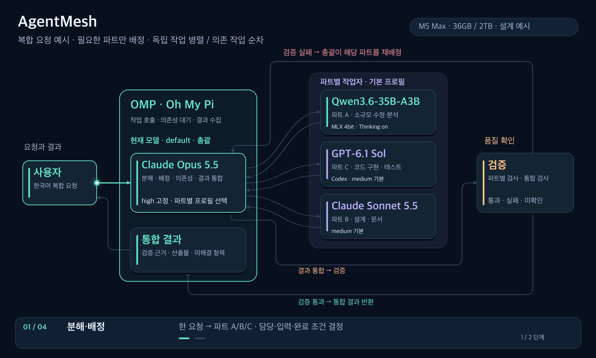

# AgentMesh

한국어 요청을 **Qwen 4B가 라우터로 판단해 Qwen 35B 또는 클라우드에 위임**하는 작업 환경입니다. 간단한 요청은 4B가 직접 처리합니다. 기준 장비는 **M5 Max · 통합 메모리 36GB · SSD 2TB**입니다.

이 저장소는 구조와 운영 규칙을 관리하는 **설계 문서**입니다. 로컬 모델 설치, OMP 설정과 자동 위임 구현이 완료됐다는 뜻은 아닙니다.

## 작업 환경 구조

**4B 자체가 판단하는 라우터입니다.** 4B 앞에 별도의 판단용 라우터를 두지 않습니다. 클라우드 작업은 4B에서 바로 넘기며, 35B는 필수 중간 단계가 아닙니다.

버튼 없이 자동 반복되는 **1600×960 · 50fps** GIF입니다. 프레임당 20ms, 한 주기 29초이며 간단한 응답, 로컬 분석, 코드 구현, 설계, 실패 후 재작업을 보여줍니다. 이동 속도는 설명용이며 모델의 실제 판단·처리 시간과 무관합니다. 실제 재생 속도는 뷰어와 기기에 따라 달라질 수 있습니다.

## 구성요소와 책임

| 구성요소 | 역할 |
| --- | --- |
| OMP (Oh My Pi) | 한국어 요청과 대화 문맥 접수, 4B가 선택한 작업자 실행, 상태·최종 결과 반환 |
| **Qwen 4B = 라우터** | 의도·복잡도·제약을 판단해 직접 응답 / 35B / 클라우드 중 선택; 실패 시 재배정 |
| Qwen 35B | 4B가 로컬 처리로 배정한 분석·요구사항 정리·초안 작업 |
| Codex | 4B가 배정한 클라우드 코드 구현·수정·테스트 작업의 우선 후보 |
| Claude | 4B가 배정한 클라우드 설계·복잡한 추론·검토 작업의 우선 후보 |
| 검증 | 완료 조건·테스트·근거를 확인해 통과·실패·미확인으로 판정 |

실행 코드는 모델 호출과 메모리·권한·예산 제한을 적용합니다. **의미를 판단하는 담당은 4B**, 그 판단을 실행하는 쪽은 OMP와 연결 도구입니다. 검증은 별도의 모델명이 아니라 작업별 검사 절차입니다.

## 대표 요청 흐름

| 작업 | 흐름 |
| --- | --- |
| 간단한 응답 | OMP → **4B 판단·직접 응답** → 검증 → OMP 반환 |
| 로컬 분석 | OMP → **4B 판단** → **35B** → 검증 → OMP 반환 |
| 코드 구현 | OMP → **4B 판단** → **Codex** → 검증 → OMP 반환 |
| 설계·추론 | OMP → **4B 판단** → **Claude** → 검증 → OMP 반환 |
| 실패 후 재작업 | 검증 실패 → **4B 재판단** → 선택한 작업자 → 재검증 → 통과 시 OMP 반환 |

재작업 애니메이션은 4B가 Codex에 수정을 맡기는 예시입니다. 실제 담당은 실패 원인에 따라 정합니다. 35B가 처리하기 어려운 경우에도 실패·제약 근거를 4B에 돌려 재배정합니다.

## OMP에서 선택할 모델

**평소 사용자와 대화하는 기본 모델은 Qwen3.5-4B 4bit로 선택합니다.** 35B와 클라우드는 4B가 호출할 작업자로 연결합니다.

| 선택 위치 | 추천 모델·역할 |
| --- | --- |
| 현재 대화 모델 및 `default` 역할 | **Qwen3.5-4B 4bit** — 한국어 요청 판단과 간단한 직접 응답 |
| 로컬 작업자 | **Qwen3.6-35B-A3B 4bit** — 로컬 분석·초안 |
| 코드 작업자 | 사용 가능한 Codex 계열 클라우드 모델 |
| 설계·검토 작업자 | 사용 가능한 Claude 클라우드 모델 |

로컬 배포 후보는 [Qwen3.5-4B MLX 4bit](https://huggingface.co/mlx-community/Qwen3.5-4B-MLX-4bit), [Qwen3.6-35B-A3B MLX 4bit](https://huggingface.co/mlx-community/Qwen3.6-35B-A3B-4bit)입니다. 모델 식별자는 로컬 서버가 실제로 제공하는 값을 사용하며, 표시명만으로 연결됐다고 판단하지 않습니다.

1. oMLX 등 로컬 서버에서 모델을 제공하고 OMP에 해당 공급자·모델을 등록합니다. 목록에 4B가 없으면 이 연결부터 확인합니다.
2. OMP의 `/model`에서 4B를 현재 대화 모델로 선택하고, Roles에서 `default`에도 4B를 지정합니다. 세션 모델 선택과 기본 역할 저장은 구분합니다.
3. 35B·코드·설계 작업자를 각각 정의하고 모델 또는 역할을 명시적으로 연결합니다. 4B에는 배정 기준과 사용할 작업자 이름을 알려주고, `task` 도구 등으로 선택한 작업자를 실행하게 합니다.
4. 각 작업자를 실제 호출해 모델 식별자, 인계된 원문, 실행 결과와 검증 결과를 확인합니다. 작업자의 모델 연결이 없으면 상위 세션의 4B를 물려받을 수 있으므로 별도 확인합니다.

**4B를 선택하는 것만으로 자동 위임이 완성되지는 않습니다.** 모델 등록, 작업자 연결, 4B의 라우팅 지침과 도구 호출 검증이 필요합니다. 이 저장소는 그 설정 파일이나 실행 코드를 설치하지 않습니다.

그림의 Codex·Claude는 클라우드 작업 역할명입니다. OMP 작업자에서 클라우드 모델을 호출하는 방식과 별도의 Codex·Claude Code 실행기를 호출하는 방식은 구분해야 합니다. 전자는 OMP 모델·작업자 연결로 구성하고, 후자는 추가 실행기 연동이 필요합니다.

선택과 위임 방식은 [OMP 모델 문서](https://github.com/can1357/oh-my-pi/blob/main/docs/models.md), [작업자 모델 연결 문서](https://github.com/can1357/oh-my-pi/blob/main/docs/task-agent-discovery.md)를 기준으로 합니다.

## M5 Max 36GB 운영 기준

- **4B는 상주를 우선**하고 라우팅은 짧은 입력과 짧은 배정 결과로 처리합니다. 긴 추론은 끄는 것을 시작점으로 삼되 한국어 분류 정확도를 확인합니다.
- **35B는 필요할 때 로드**합니다. 4B와 35B의 동시 상주 가능 여부는 OS·개발 도구·문맥 캐시를 포함한 실제 메모리 사용량으로 판단합니다.
- 로컬 추론은 한 번에 하나부터 시작합니다. 메모리가 부족하면 진행 상태를 저장하고 불필요한 모델·캐시를 해제합니다. 4B까지 해제했다면 다음 판단 전에 다시 로드합니다.
- 2TB SSD는 모델·작업 기록·문맥 캐시 보관에 활용합니다. SSD 용량을 사용 가능한 추론 메모리로 계산하지 않습니다.
- 4B 판단 시간, 35B 로딩 시간, 실제 작업 완료 시간을 따로 측정합니다. 아직 검증하지 않은 속도나 라우팅 정확도를 보장하지 않습니다.

한국어 후속 요청에는 필요한 이전 대화와 작업 상태를 전달합니다. 전문 작업자에게는 **4B의 요약만 보내지 않고 원래 요청·제약·관련 자료를 함께 인계**합니다. 상세 기준은 [운영 규칙](RULES.md)에 기록합니다.

## 저장소 구성

- [README.md](README.md) — 구조, 대표 흐름과 OMP 모델 선택
- [RULES.md](RULES.md) — 4B 판단, 인계, 메모리, 검증과 재작업 기준
- [AGENTS.md](AGENTS.md) — 문서·구조도 수정 기준
- [docs/traffic-flow.gif](docs/traffic-flow.gif) — 4B 라우터의 다섯 가지 자동 반복 흐름
