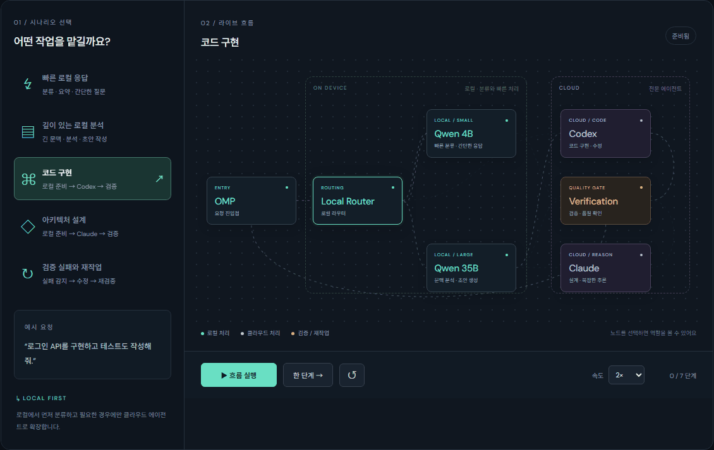

# AgentMesh

**요청 하나, 최적의 경로.** 로컬 모델과 클라우드 에이전트 사이의 요청 흐름을 한국어로 살펴보는 인터랙티브 아키텍처 시뮬레이터입니다.

OMP → Local Router → Qwen 4B / Qwen 35B → Codex / Claude → Verification → OMP의 흐름을 움직이는 패킷과 단계별 타임라인으로 보여줍니다.

## 트래픽 애니메이션 미리보기



실제 앱 화면을 녹화한 반복 재생 GIF입니다. **코드 구현 → 검증 완료**, **검증 실패 → Codex 재작업 → 재검증** 시나리오가 순서대로 재생됩니다. README에서는 자동 재생 미리보기를 보고, 아래 실행 방법으로 앱을 열면 시나리오·속도·일시정지를 직접 조절할 수 있습니다. GitHub나 기기의 동작 줄이기 설정에 따라 애니메이션이 멈춰 보일 수 있습니다.

> 실제 모델이나 API를 호출하지 않는 설계 데모입니다. 지연 시간, 비용, 처리량 또는 모델의 실제 성능을 측정하지 않습니다. OMP는 이 프로젝트의 요청 진입점 역할명이며 특정 제품과의 연동을 뜻하지 않습니다. Qwen 4B / 35B 역시 역할을 설명하는 표시명으로, 특정 모델 배포판을 지정하지 않습니다.

## 실행

Node.js 22 이상에서 외부 패키지 설치 없이 실행합니다.

```sh
git clone https://github.com/qmdch1/AgentMesh.git
cd AgentMesh
npm start
```

브라우저에서 **http://127.0.0.1:4173** 을 엽니다. 종료는 `Ctrl+C`. 포트는 `PORT` 환경변수로 변경할 수 있습니다. ES 모듈을 사용하므로 `index.html`을 직접 더블클릭하는 대신 HTTP 서버로 열어 주세요. Google Fonts를 불러오지 못하면 시스템 글꼴을 사용하며, 앱은 정상 작동합니다.

## 사용법

- 왼쪽에서 시나리오를 선택합니다. 선택을 바꾸면 이전 실행과 기록이 초기화됩니다.
- **흐름 실행**으로 재생하고 같은 버튼으로 일시정지하거나 이어서 실행합니다.
- **한 단계 →**로 이동을 하나씩 완료합니다. **↺**는 처음으로 되돌립니다.
- 속도를 **0.5× / 1× / 2×**로 바꿉니다. 변경 사항은 진행 중인 이동에 즉시 적용됩니다.
- 노드를 클릭하거나 키보드로 선택하면 하단에 역할이 표시됩니다.
- 민트색은 로컬 이동, 보라색은 클라우드 이동, 주황색은 실패 후 재작업입니다. 텍스트 기록으로도 구분됩니다.
- 작은 화면에서는 맵 영역만 가로 스크롤합니다. OS의 동작 줄이기 설정을 켜면 패킷 이동 없이 단계와 기록이 갱신됩니다.

| 시나리오 | 주요 경로 |
| --- | --- |
| 빠른 로컬 응답 | OMP → Router → 4B → 검증 → OMP |
| 깊이 있는 로컬 분석 | OMP → Router → 4B → Router → 35B → 검증 → OMP |
| 코드 구현 | OMP → Router → 4B → Router → 35B → Codex → 검증 → OMP |
| 아키텍처 설계 | OMP → Router → 4B → Router → 35B → Claude → 검증 → OMP |
| 검증 실패와 재작업 | OMP → Router → 4B → Router → Codex → 검증 실패 → Codex → 재검증 → OMP |

## 구조와 수정

```text
index.html                 한국어 화면 구조
src/styles.css             반응형 레이아웃, 노드, 경로 스타일
src/flows.js               노드 역할, 좌표, 시나리오, 순수 상태 전이
src/app.js                 SVG 패킷 이동, 실행 제어, 타임라인
server.js                  로컬 확인용 정적 서버
tests/                     경로 무결성 및 브라우저 동작 검사
.github/workflows/test.yml GitHub Actions 자동 검사
```

새 경로는 `src/flows.js`의 `scenarios`에 추가합니다. 각 단계의 `from` / `to`는 `nodes`의 ID를 참조하며 이전 단계의 도착점과 다음 단계의 출발점을 연결해야 합니다. 경로는 자동으로 생성됩니다. 새 노드는 맵의 920×490 좌표계에 배치합니다. `local`, `cloud`, `retry`, `verified`로 단계 성격을 지정합니다.

운영 연동 시에는 별도의 백엔드에서 모델 호출, 인증, 요청 추적과 실제 검증을 구현해야 합니다. 현재의 검증 실패 및 통과는 사전에 정한 시나리오입니다. API 키를 프런트엔드에 넣지 마세요.

## 검증

개발용 의존성을 설치한 뒤 실행합니다.

```sh
npm ci
npm test
npx playwright install chromium
npm run test:browser
```

경로 연결, 로컬 전용 경로, 재검증, 상태 전이, 전체 시나리오 완주, 패킷 이동, 일시정지와 재개, 초기화, 시나리오 전환, 모바일 화면 및 동작 줄이기를 검사합니다. 브라우저 검사는 로컬 서버를 자동으로 시작합니다. GitHub Actions에서도 같은 검사를 실행합니다.

## 정적 호스팅

빌드 과정 없이 `index.html`과 `src/`를 정적 호스팅에 올리면 됩니다. GitHub Pages에서는 저장소 **Settings → Pages → Deploy from a branch → main / (root)** 로 설정할 수 있습니다. 경로는 상대 URL이므로 `/AgentMesh/` 하위에서도 작동합니다. 저장소 푸시와 웹사이트 공개는 별도이며, 이 저장소는 Pages를 자동 활성화하지 않습니다.
